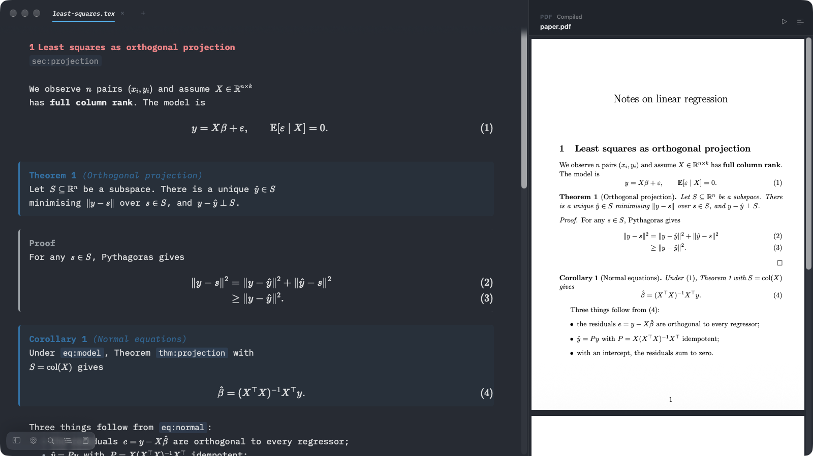

# Chalk

Chalk is a Markdown and LaTeX editor for writing mathematics.
Equations, theorems, proofs and Beamer frames render in the same pane as the source, and the PDF compiles with your own TeX, pandoc or Quarto.


It comes as a native Mac app and as a VS Code extension, built on one editor engine.

## Features

**Editing**

- Inline and display math render with KaTeX when the cursor leaves them; move back in to edit the source.
- `equation` and `align` blocks are numbered as you write. References work with `\label`/`\eqref` in LaTeX and `{#eq-…}`/`@eq-…` in Markdown and Quarto.
- Theorems, lemmas, definitions, proofs and callouts render as cards, from LaTeX environments or Quarto fenced divs (`::: {#thm-…}`, `::: {.proof}`, `::: {.callout-note}`).
- Beamer frames render as numbered slide cards.
- Markdown: tables you edit in place, images, and Mermaid diagrams under their source.
- HyperSnips-style snippets: `dm` opens an `align` block, `1/` starts a fraction, `;m` is `\mu`, Tab jumps to the next field. Your own `.hsnips` files work unchanged.
- Three view modes (preview, mixed, source), zen, typewriter and focus modes, and four colour themes in light and dark.


**Mac app**

- Tabs, a folder sidebar, an outline panel with a word count, and a split view for two files side by side (Cmd+\\).
- Cmd+R compiles and shows the PDF beside the text.
- The PDF and the source are linked (SyncTeX): Cmd-click a spot in the PDF to jump to its line in the source, and press Option+Cmd+J to find the caret's line in the PDF.
- Multi-file projects: saving a chapter compiles the root file, found from `% !TEX root`, the `\input`/`\include` graph or the last build.
- LaTeX builds with latexmk when installed, otherwise pdflatex, xelatex or lualatex with bibtex or biber, or tectonic. Markdown and Quarto build with Quarto or pandoc.
- Compile errors are listed under the PDF; a click jumps to the line.
- TikZ pictures (`tikzpicture` and `tikzcd` in LaTeX, ```` ```tikz ```` fences in Markdown and Quarto) render under their source, typeset by your own TeX installation with your preamble.



**VS Code extension**

- Opens `.tex`, `.md` and `.qmd` files in the Chalk editor.
- Builds LaTeX with your LaTeX Workshop recipe, on save or with Cmd+Alt+B; a click in the PDF jumps back to the source.
- Not yet: jumping from the source to the PDF.


## How it compares

|                                     | Chalk | Typora   | Obsidian        | Overleaf                 | LyX                      |
| ----------------------------------- | ----- | -------- | --------------- | ------------------------ | ------------------------ |
| Edits `.tex` files as they are      | yes   | no       | no              | yes                      | imports and exports them |
| Edits Markdown and Quarto           | yes   | Markdown | Markdown        | no                       | no                       |
| Compiles with your own TeX, offline | yes   | no       | through plugins | no                       | yes                      |
| Open source                         | MIT   | no       | no              | Community Edition (AGPL) | GPL                      |
| Price                               | free  | paid     | free            | free plan, paid plans    | free                     |

Chalk has no real-time collaboration; for co-writing, Overleaf is the better fit.

## Requirements for compiling

Chalk uses the tools on your shell's `PATH`:

- LaTeX: a TeX distribution such as [MacTeX](https://tug.org/mactex/) or BasicTeX, or [tectonic](https://tectonic-typesetting.github.io).
- Markdown: [Quarto](https://quarto.org) or [pandoc](https://pandoc.org), plus a TeX distribution for the PDF.

Settings > Compile shows which tools Chalk found.

## Build from source

You need macOS with Xcode, [XcodeGen](https://github.com/yonaskolb/XcodeGen) (`brew install xcodegen`), Node.js and [pnpm](https://pnpm.io).

```bash
pnpm install
scripts/install-mac.sh        # builds the Mac app and installs it to ~/Applications
pnpm -C vscode package        # builds a .vsix for "Install from VSIX..."
```

`scripts/release-mac.sh` makes a signed build for other people; see [docs/release-steps.md](docs/release-steps.md).

## How it is built

The engine, [`@chalk/editor-core`](packages/editor-core/), is CodeMirror 6 with KaTeX and a HyperSnips port.
The Mac app (AppKit, with the editor in a `WKWebView`) and the VS Code extension (a webview) talk to it through the same small protocol.
[CLAUDE.md](CLAUDE.md) describes the architecture.

## Contributing and licence

See [CONTRIBUTING.md](CONTRIBUTING.md). Chalk is released under the [MIT License](LICENSE).
