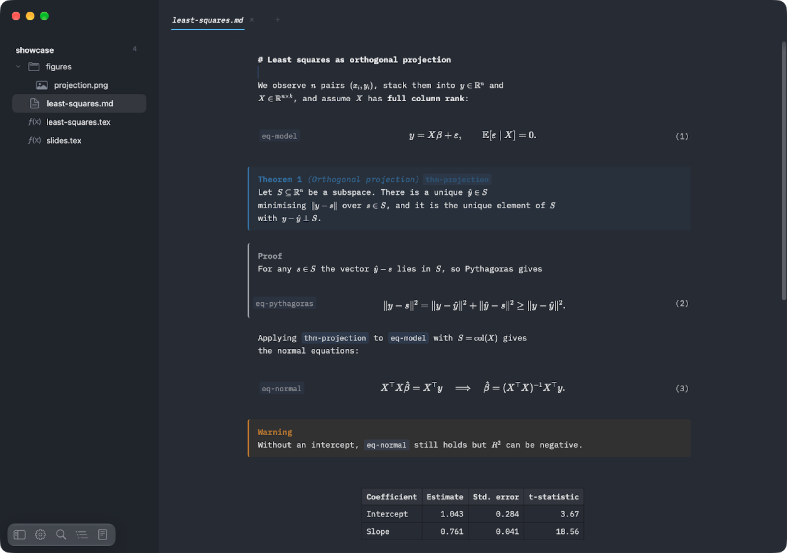
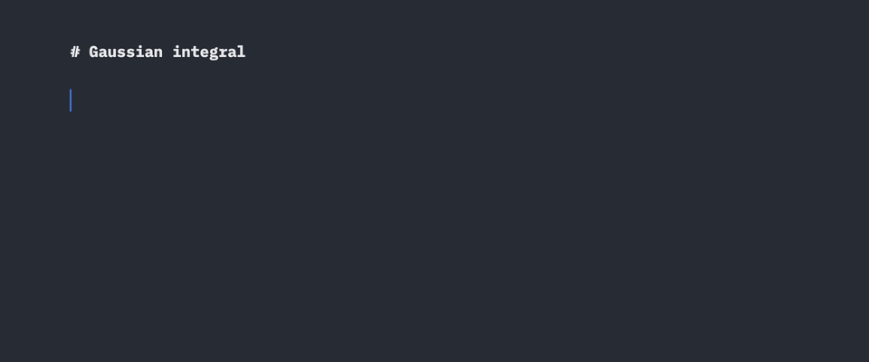
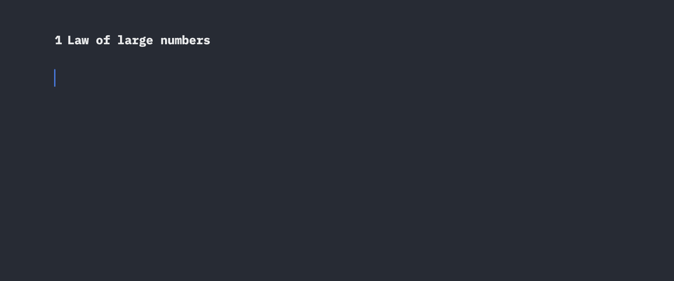
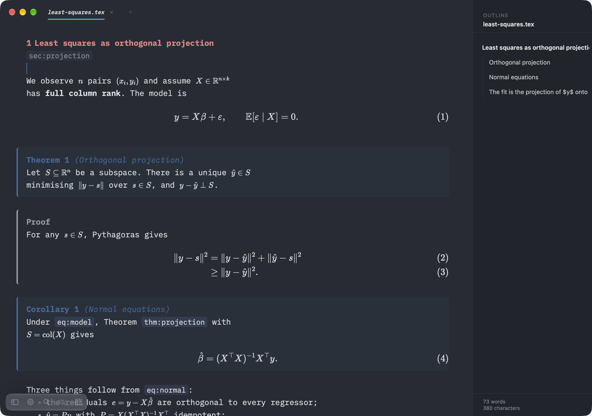
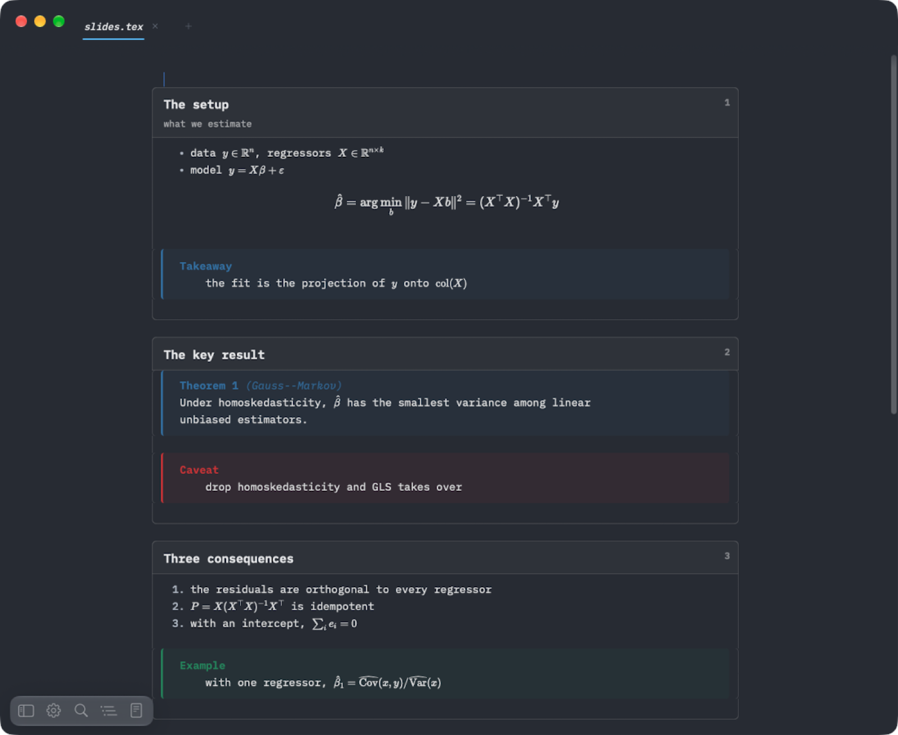
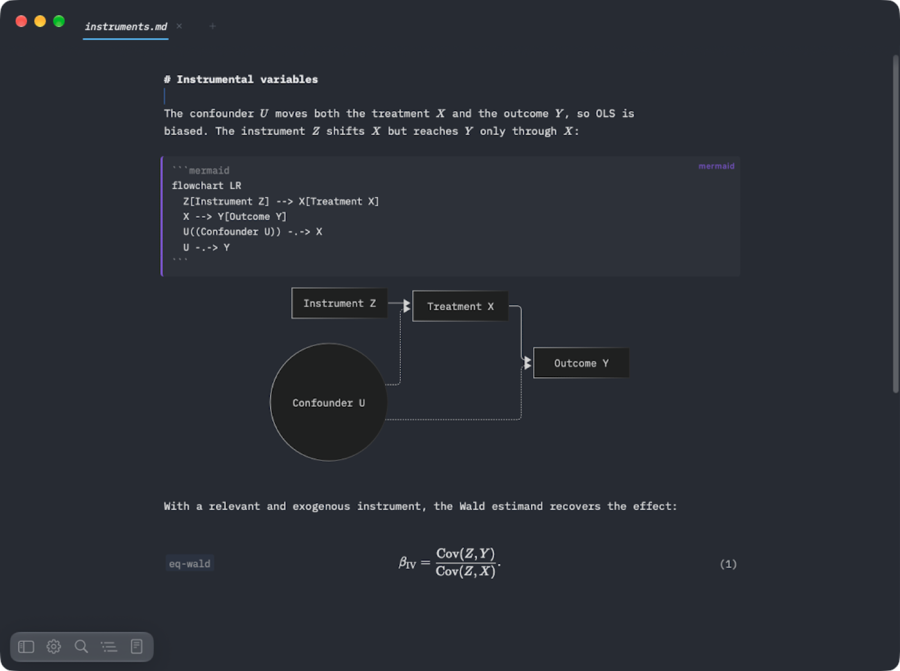
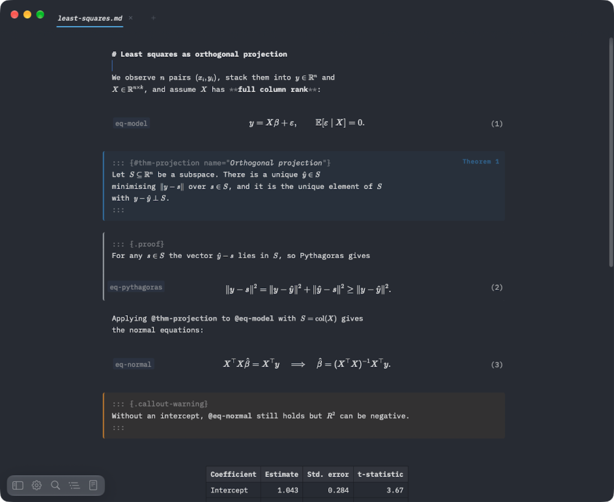
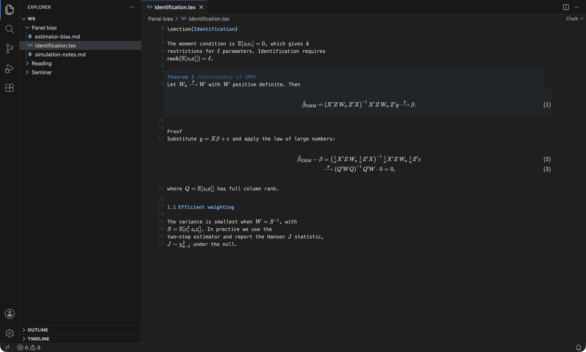

# Chalk

Chalk is a live-preview editor for `.tex` and `.md` files.
Math renders in place with KaTeX while you type, and HyperSnips-style snippets (hsnips) expand as you write.



It comes in two forms, built on one editor engine:

- **Chalk for Mac** ([mac/](mac/)): a native app with tabs, a folder sidebar and an outline panel.
- **Chalk for VS Code** ([vscode/](vscode/)): the same editor as a custom editor for `.tex`, `.md` and `.qmd` files.

## What it does



- **Live math.** Inline and display math render with KaTeX as soon as the cursor leaves them. Move back in and you edit the source.
- **LaTeX that reads like the PDF.** Sections, theorem and proof environments, numbered `equation` and `align` blocks, lists and figures render in place.
- **Cross-references.** `\label`/`\eqref` in LaTeX and Quarto's `{#eq-…}`/`@eq-…` in Markdown, with equations and theorems numbered as you write.
- **Beamer.** Each frame shows as a slide card, with blocks and theorems inside.
- **Markdown and Quarto.** Headings, lists, tables, callouts, theorem blocks, images and Mermaid diagrams.
- **Snippets.** HyperSnips-style snippets for fast math typing, with a default set included.
- **PDF on demand (Mac).** Cmd+R compiles with your own TeX (latexmk, or pdflatex/xelatex/lualatex directly, or tectonic), pandoc or Quarto (Settings picks which compiles Markdown; Automatic prefers Quarto, whose cross-references match the editor) and shows the PDF beside the text, with SyncTeX both ways. Cmd+S compiles too, and a chapter finds its root file on its own.
- **Three view modes.** Preview, mixed, or plain source.
- **Writing modes.** Zen, typewriter and focus.
- **Colour themes.** Atom (the default), Ink, Catppuccin and LaTeX, each in light and dark.

### Snippets



Short triggers expand as you type: `dm` opens an `align` block, `lim` gives `\lim_{n \to \infty}`, `1/` starts a fraction, `;m` is `\mu`, and Tab jumps to the next field.
The default set covers Greek letters, operators, accents and environments, and you can add your own.

### LaTeX

Theorem-like environments become cards, `equation` and `align` blocks are numbered, and `\eqref` points at them.
The outline panel lists sections and environments, with a word count.



### Beamer

Each `frame` becomes a numbered slide card with its title, and `block`, `alertblock`, `exampleblock` and theorems render inside it.



### Mermaid diagrams

A `mermaid` code block keeps its source and draws the diagram under it.



### Mixed view

Mixed view keeps the markup visible but dimmed, while math, images and tables still render.



### In VS Code



The extension can also build your LaTeX project on save (`chalk.latex.buildOnSave`) with your LaTeX Workshop recipe, finding the root of a multi-file project from a `% !TEX root` comment, the include graph or the last build's `.fls`.
Cmd+Alt+B builds and Cmd+Alt+V opens LaTeX Workshop's PDF viewer from a Chalk tab, and a click in that PDF jumps back into the Chalk editor.
Jumping from the source to the PDF (forward SyncTeX) is not available from a Chalk tab yet: LaTeX Workshop only offers it from its own text editor.

## How it is built

The engine, [`@chalk/editor-core`](packages/editor-core/), is CodeMirror 6 plus KaTeX plus a self-contained hsnips port.
It knows nothing about its host. Each host talks to it through the same small `HostPort` protocol.
The Mac app is native AppKit and hosts the editor in a `WKWebView`; the VS Code extension hosts it in a webview.

## Repository layout

```
├─ mac/                  the Mac app (Swift, AppKit)
│   ├─ project.yml       XcodeGen spec; mac/Chalk.xcodeproj is generated from it
│   ├─ Chalk/            app shell: window, tabs, Library sidebar, documents, settings
│   ├─ ChalkKit/         pure-Foundation Swift package (protocol types, buffers, bookmarks, chrome rules)
│   └─ ChalkTests/       XCTest bundle for the app
├─ packages/editor-core/ the shared editor engine (TypeScript)
├─ web/                  builds editor-core into the bundle the Mac app loads
│   └─ src/native-host.ts   HostPort over the WKWebView message bridge
├─ vscode/               the VS Code extension
├─ Tests/                browser test harnesses (Playwright), fixtures and snapshots
├─ scripts/              check, install, release and generator scripts
├─ test-docs/            sample documents for trying the editor by hand
└─ docs/                 design specs, issue notes, test and release notes
```

## Build from source

Prerequisites:

- macOS with Xcode (for the Mac app)
- [XcodeGen](https://github.com/yonaskolb/XcodeGen) (`brew install xcodegen`)
- Node.js and [pnpm](https://pnpm.io)

Install the JavaScript workspace first. Everything JavaScript (editor-core, the extension, the app's web bundle) is one pnpm workspace with one lockfile.

```bash
pnpm install
```

### Mac app

```bash
cd mac && xcodegen generate
```

Then either:

- run `scripts/install-mac.sh`, which builds a Release copy, signs it ad hoc and installs it to `~/Applications/Chalk.app`, or
- open `mac/Chalk.xcodeproj` in Xcode and run the `Chalk` scheme on "My Mac".

An Xcode build phase rebuilds the editor bundle (`node web/build.mjs`) on every build, so it needs the `pnpm install` above.
Run `pnpm web:build` to rebuild the bundle by hand.

Local builds are not tied to an Apple developer team.
`scripts/release-mac.sh` makes a signed build for other people; see [docs/release-steps.md](docs/release-steps.md).

### VS Code extension

```bash
pnpm -C vscode build      # dist/extension.js and dist/webview.js
pnpm -C vscode package    # a .vsix you can install with "Install from VSIX..."
```

To debug it, open the repo in VS Code and run the "Run Chalk Extension" launch configuration.

## Tests

| Command             | What it runs                                                                                                    |
| ------------------- | --------------------------------------------------------------------------------------------------------------- |
| `scripts/check.sh`  | everything below plus the Xcode suites and benchmarks; `--fast` skips the slow parts, `--list` names every step |
| `pnpm test`         | the editor-core and extension unit tests (vitest, jsdom)                                                        |
| `pnpm typecheck`    | TypeScript across the workspace                                                                                 |
| `pnpm test:swift`   | the ChalkKit Swift package tests, from the command line                                                         |
| `pnpm test:browser` | browser scenarios over the built editor (Playwright, Chromium)                                                  |
| `pnpm test:caret`   | caret and mouse fixtures in `Tests/fixtures`                                                                    |

The browser runners need Playwright's browsers once: `npx playwright install chromium webkit`.

## How the engine is shared

`@chalk/editor-core` has one entry point, `mountEditor(opts)`, and one contract, `HostPort`.
`HostPort` is a frozen 9-message protocol.
Host to editor: `init`, `update`, `theme-colors`, `heading-colors`, `editor-config`, `hsnips`.
Editor to host: `ready`, `edit`, `open-external`.

```
Mac app (Swift, UIKit)                   VS Code extension host (Node)
  ↕ WKWebView message bridge               ↕ webview postMessage
web/src/native-host.ts                     vscode/src/webview-entry.ts
        └────────── mountEditor(HostPort) ──────────┘
                @chalk/editor-core (CodeMirror 6 + KaTeX + hsnips)
```

The Swift `Codable` mirrors of the protocol live in `mac/ChalkKit/Sources/ChalkKit/HostProtocol.swift`.
Edits are buffered by the host and written on save; there is no autosave.

## Contributing

See [CONTRIBUTING.md](CONTRIBUTING.md).
[CLAUDE.md](CLAUDE.md) describes the architecture and the rules for code and comments in more detail.

## Licence

Chalk is released under the [MIT License](LICENSE).
Bundled third-party components keep their own licences, listed in [THIRD-PARTY-NOTICES](THIRD-PARTY-NOTICES).
