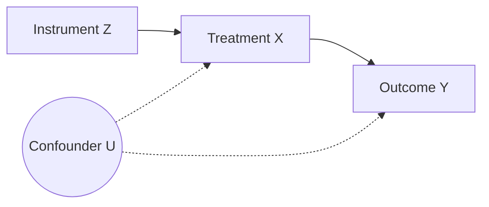

# Instrumental variables

The confounder $U$ moves both the treatment $X$ and the outcome $Y$, so OLS is
biased. The instrument $Z$ shifts $X$ but reaches $Y$ only through $X$:

With a relevant and exogenous instrument, the Wald estimand recovers the effect:

$$
\beta_{\text{IV}} = \frac{\operatorname{Cov}(Z, Y)}{\operatorname{Cov}(Z, X)} .
$$ {#eq-wald}
