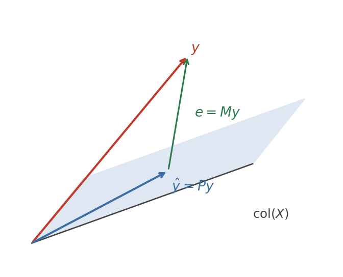
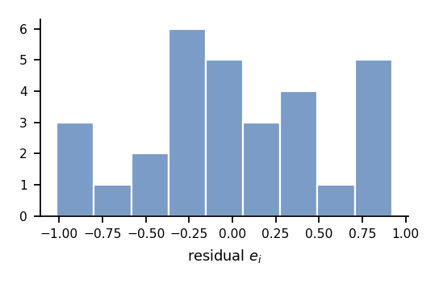
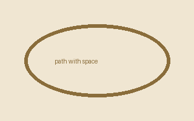

Everything below is one connected argument: least squares is nothing but orthogonal projection onto a column space, and every classical result about it falls out of that single geometric fact. Read it top to bottom and it should make sense; skim it and every renderer feature should be visible at once.

The last section, @sec-edge, is a deliberate stress test and is *not* meant to read as mathematics.

# Setup and notation {#sec-setup}

We observe $n$ pairs $(x_i, y_i)$ and stack them into a vector
$y \in \mathbb{R}^n$ and a matrix $X \in \mathbb{R}^{n \times k}$ whose columns are the regressors. Throughout, $k < n$ and $X$ has **full column rank**, so $X^\top X$ is invertible. The model is
$$
y = X\beta + \varepsilon, \qquad \mathbb{E}[\varepsilon \mid X] = 0,
\qquad \operatorname{Var}(\varepsilon \mid X) = \sigma^2 I_n .
$$ {#eq-model}
Two objects do all the work. The *hat matrix* and the *residual maker*:
$$
P = X(X^\top X)^{-1} X^\top, \qquad M = I_n - P .
$$ {#eq-hat}
A display block with no label carries no number, which is what you want for a throwaway line:
$$
\|v\|^2 = \langle v, v \rangle = \sum_{i=1}^n v_i^2 .
$$
Inline math should sit on the text baseline without stretching the line box: the estimator $\hat\beta = (X^\top X)^{-1} X^\top y$, the fitted values $\hat y = Py$, the residuals $e = My$, and a fraction inline,$\hat\sigma^2 = \frac{e^\top e}{n - k}$, which is taller than the line.

> A blockquote with inline math, $\|Py\| \le \|y\|$, and a display block:
>
> $$
> \langle Py,\, My \rangle = 0 .
> $$
>
> The quote bar should run the full height of both.

# The projection theorem {#sec-projection}

::: {#def-inner-product name="Inner product and orthogonality"}
For $u, v \in \mathbb{R}^n$ write $\langle u, v \rangle = u^\top v$. Vectors
$u$ and $v$ are **orthogonal**, written $u \perp v$, when
$\langle u, v \rangle = 0$. A vector is orthogonal to a subspace
$S \subseteq \mathbb{R}^n$ when it is orthogonal to every element of $S$, and
the set of all such vectors is the orthogonal complement

$$
S^{\perp} = \{ v \in \mathbb{R}^n : \langle v, s \rangle = 0 \text{ for all } s \in S \} .
$$ {#eq-complement}
:::

::: {#thm-projection name="Orthogonal projection"}
Let $S \subseteq \mathbb{R}^n$ be a subspace and $y \in \mathbb{R}^n$. There is
a unique $\hat y \in S$ minimising $\|y - s\|$ over $s \in S$, and it is the
unique element of $S$ with $y - \hat y \in S^{\perp}$.
:::

::: {.proof}
Existence is the usual compactness argument; we prove the characterisation,
which is the part we actually use. Suppose $\hat y \in S$ and
$y - \hat y \in S^{\perp}$. For any $s \in S$ the difference $\hat y - s$ lies
in $S$, so it is orthogonal to $y - \hat y$ and Pythagoras applies:

$$
\|y - s\|^2 = \|(y - \hat y) + (\hat y - s)\|^2
            = \|y - \hat y\|^2 + \|\hat y - s\|^2
            \ge \|y - \hat y\|^2 ,
$$ {#eq-pythagoras}

with equality exactly when $\hat y = s$. That gives both minimality and uniqueness. Conversely, if $\hat y$ minimises the distance, then for every $s \in S$ and every $t \in \mathbb{R}$ the scalar function $t \mapsto \|y - \hat y - t s\|^2$ is minimised at $t = 0$; differentiating and setting the derivative to zero gives $\langle y - \hat y, s \rangle = 0$.
:::

Applying @thm-projection with $S = \operatorname{col}(X)$ turns the geometry into linear algebra.

::: {#cor-normal name="Normal equations"}
The minimiser of $\|y - X b\|$ over $b \in \mathbb{R}^k$ solves

$$
X^\top X b = X^\top y ,
$$ {#eq-normal}

and under full column rank it is unique:
$\hat\beta = (X^\top X)^{-1} X^\top y$, so $\hat y = Py$ with $P$ as in @eq-hat.
:::

::: {.proof}
By @thm-projection the residual $y - Xb$ must be orthogonal to every column of $X$, that is $X^\top (y - Xb) = 0$, which rearranges to (-@eq-normal).
Invertibility of $X^\top X$ follows from full column rank.
:::

{#fig-projection}

# Consequences {#sec-consequences}

::: {#lem-idempotent name="Both projectors are idempotent and symmetric"}
$P^\top = P$, $P^2 = P$, $M^\top = M$, $M^2 = M$, and $PM = MP = 0$.
:::

::: {.proof}
Symmetry of $P$ is immediate from @eq-hat since
$(X^\top X)^{-1}$ is symmetric. For idempotence,

$$
P^2 = X(X^\top X)^{-1} \underbrace{X^\top X (X^\top X)^{-1}}_{= I_k} X^\top = P .
$$

The claims about $M = I - P$ follow by expanding, and
$PM = P(I - P) = P - P^2 = 0$.
:::

::: {#prp-gauss-markov name="Gauss–Markov"}
Under @eq-model, $\hat\beta$ is unbiased and has variance
$\sigma^2 (X^\top X)^{-1}$. Among all linear unbiased estimators
$\tilde\beta = Cy$ it has the smallest variance, in the sense that
$\operatorname{Var}(\tilde\beta) - \operatorname{Var}(\hat\beta)$ is positive
semi-definite.
:::

::: {.proof}
Write $C = (X^\top X)^{-1} X^\top + D$. Unbiasedness of $\tilde\beta$ for every
$\beta$ forces $DX = 0$, and then

$$
\operatorname{Var}(\tilde\beta)
  = \sigma^2 \left[ (X^\top X)^{-1} + D D^\top \right]
  = \operatorname{Var}(\hat\beta) + \sigma^2 D D^\top ,
$$ {#eq-gm}

because the cross terms carry a factor $DX = 0$. The matrix $DD^\top$ is
positive semi-definite, which is the claim.
:::

::: {.remark}
@prp-gauss-markov is a statement about *linear* estimators only, and it needs
homoskedasticity. Both restrictions matter: drop the second and the efficient
estimator is generalised least squares, $\hat\beta_{\text{GLS}} = (X^\top
\Omega^{-1} X)^{-1} X^\top \Omega^{-1} y$.
:::

The decomposition of the sum of squares is now one line. Since
$y = Py + My$ with the two pieces orthogonal,

$$
\underbrace{\|y - \bar y \mathbf{1}\|^2}_{\text{TSS}}
  = \underbrace{\|\hat y - \bar y \mathbf{1}\|^2}_{\text{ESS}}
  + \underbrace{\|e\|^2}_{\text{RSS}} ,
\qquad R^2 = \frac{\text{ESS}}{\text{TSS}} = 1 - \frac{\text{RSS}}{\text{TSS}} ,
$$ {#eq-anova}

provided the regression includes an intercept, so that $\mathbf{1} \in
\operatorname{col}(X)$.

::: {.callout-warning}
Without an intercept, $\bar e \neq 0$ and (-@eq-anova) fails; $R^2$ computed
from the usual formula can then be negative. This is the single most common
way to misread regression output.
:::

# A worked example {#sec-example}

::: {#exm-bivariate name="The bivariate case"}
With $k = 2$ and $X = [\mathbf{1} \;\; x]$, the normal equations @eq-normal
reduce to two scalar equations whose solution is

$$
\hat\beta_1 = \frac{\sum_i (x_i - \bar x)(y_i - \bar y)}{\sum_i (x_i - \bar x)^2}
            = \frac{\widehat{\operatorname{Cov}}(x, y)}{\widehat{\operatorname{Var}}(x)},
\qquad
\hat\beta_0 = \bar y - \hat\beta_1 \bar x .
$$ {#eq-bivariate}

So the slope is a covariance-to-variance ratio and the fitted line passes
through the point of means $(\bar x, \bar y)$.
:::

Fitting @eq-bivariate to $n = 30$ simulated points gives the picture below.
The grey segments are the residuals $e_i$ that (-@eq-anova) squares and sums.

{#fig-scatter}

Estimates, with the quantities from @sec-consequences:

| Coefficient             | Estimate | Std. error | $t$-statistic | $p$-value |
| :---------------------- | -------: | ---------: | ------------: | :-------: |
| $\\hat\\beta_0$ (const) |    1.043 |      0.284 |          3.67 |   0.001   |
| $\\hat\\beta_1$ ($x$)   |    0.761 |      0.041 |         18.56 |  < 0.001  |
| $\\hat\\sigma$          |    0.802 |            |               |           |
| $R^2$                   |    0.925 |            |               |           |

: Ordinary least squares, $n = 30$. {#tbl-estimates}

The residuals look symmetric, which is consistent with, though hardly proof of,
the homoskedasticity that @prp-gauss-markov assumes:

{#fig-residuals}

::: {#exr-r2 name="Uncentred $R^2$"}
Show that if $X$ contains no column of ones, the identity in @eq-anova holds
with $\bar y$ replaced by $0$, and that the resulting *uncentred* $R^2$ lies in
$[0, 1]$ even though the centred one need not.
:::

::: {.solution}
Orthogonality gives $\|y\|^2 = \|\hat y\|^2 + \|e\|^2$ for any $X$, since that
statement never mentions $\mathbf{1}$. Dividing through by $\|y\|^2$ puts
$\|\hat y\|^2 / \|y\|^2$ in $[0, 1]$. The centred version subtracts
$n \bar y^2$ from both sides, and that subtraction is only legitimate when
$\mathbf{1} \in \operatorname{col}(X)$.
:::

# Historical note and references {#sec-history}

The method appeared in print first in [@legendre1805], as an appendix on comet
orbits, and was published with its probabilistic justification four years later
by Gauss [@gauss1809], who claimed to have used it since 1795. The priority
dispute is told carefully in [@stigler1981, pp. 465–474]. The projection
formulation used here is standard; see [@hansen2022, ch. 3] or
[@davidson-mackinnon1993, §1.4] for textbook treatments, and [@strang2016] for
the linear algebra.

Multiple keys in one bracket: [@legendre1805; @gauss1809; @stigler1981].
An in-text citation with a suppressed author: @hansen2022 [-@hansen2022] shows
the same decomposition.

## Bibliography

- [@davidson-mackinnon1993] Davidson, R. and MacKinnon, J. G. (1993).
  *Estimation and Inference in Econometrics*. Oxford University Press.
- [@gauss1809] Gauss, C. F. (1809). *Theoria Motus Corporum Coelestium*.
- [@hansen2022] Hansen, B. E. (2022). *Econometrics*. Princeton University Press.
- [@legendre1805] Legendre, A. M. (1805). *Nouvelles méthodes pour la
  détermination des orbites des comètes*.
- [@stigler1981] Stigler, S. M. (1981). Gauss and the invention of least
  squares. *Annals of Statistics*, 9(3), 465–474.
- [@strang2016] Strang, G. (2016). *Introduction to Linear Algebra*, 5th ed.

---

# Edge cases {#sec-edge}

Nothing below is mathematics; it is a checklist. Each subsection states what
*should* happen.

## Cross-references

| Written            | Should render as                        |
| :----------------- | :-------------------------------------- |
| `@thm-projection`  | @thm-projection                         |
| `@cor-normal`      | @cor-normal                             |
| `@eq-normal`       | @eq-normal                              |
| `-@eq-normal`      | -@eq-normal (number only)               |
| `@sec-setup`       | @sec-setup                              |
| `@def-inner-product` | @def-inner-product                    |
| `@exr-r2`          | @exr-r2                                 |
| `@fig-scatter`     | @fig-scatter (unresolved: floats are deferred) |
| `@tbl-estimates`   | @tbl-estimates (unresolved, same reason) |
| `@eq-does-not-exist` | @eq-does-not-exist (unresolved)       |
| `@notakind-foo`    | @notakind-foo (plain text, unknown kind) |

These must **not** resolve: an email address like contact\@example.com, an
escaped \@thm-projection, a reference glued to a word as in foo@eq-normal, and
a stray at-sign inside math, $a @ b$ and $x \mathbin{@} y$.

Citation keys are not cross-references and must survive untouched:
[@gauss1809], [-@gauss1809], @gauss1809.

## Inline math

Adjacent to punctuation: ($x$), [$y$], {$z$}, $a$, $b$; $c$: $d$! and $e$?
Two in a row, $u$ $v$, and glued to text, pre$x$post.

Empty and near-empty: $ $, $x$, $$ (that last one is two dollars, not display
math). A single unmatched dollar on its own line:

$

Escaped currency: \$5 and \$10 million.

**Known trap** (this line intentionally renders as math because the dollars are
unescaped): I paid $5 for one and $10 for the other.

Math with braces and backslashes: $\{x : x > 0\}$, $\|v\|_{\infty}$,
$\text{TSS} = \sum_i (y_i - \bar y)^2$, $\overbrace{a+b}^{c}$,
$\href{https://example.com}{\text{a link inside math}}$.

Broken KaTeX (should show an error indicator, not swallow the document):
$\frac{1}{$ and $\undefinedmacro{x}$ and $\begin{matrix} a$.

Inline code must stay literal: `$x^2$`, `::: {.proof}`, `| pipe |`, `**bold**`,
and a fence marker ``` ``` ``` inside code.

## Display math

Single-line form: $$E[\hat\beta] = \beta$$

Multi-line inline form:

$$\sum_{i=1}^{n} e_i
= \mathbf{1}^\top M y
= 0$$

Aligned environment inside display math:

$$
\begin{aligned}
  (X^\top X)\hat\beta &= X^\top y \\
  \hat\beta           &= (X^\top X)^{-1} X^\top y \\
                      &= \beta + (X^\top X)^{-1} X^\top \varepsilon .
\end{aligned}
$$ {#eq-aligned}

Cases, matrices, and a very wide line that must not create a horizontal
scrollbar:

$$
\mathbb{1}\{i = j\} =
\begin{cases}
  1 & \text{if } i = j, \\
  0 & \text{otherwise},
\end{cases}
\qquad
P = \begin{pmatrix} p_{11} & \cdots & p_{1n} \\ \vdots & \ddots & \vdots \\ p_{n1} & \cdots & p_{nn} \end{pmatrix}
$$

$$
\hat\beta_{\text{GLS}} = \left( X^\top \Omega^{-1} X \right)^{-1} X^\top \Omega^{-1} y = \left( \sum_{i=1}^{n} \omega_i^{-1} x_i x_i^\top \right)^{-1} \left( \sum_{i=1}^{n} \omega_i^{-1} x_i y_i \right) \quad \text{with} \quad \Omega = \operatorname{diag}(\omega_1, \dots, \omega_n) \quad \text{and} \quad \omega_i > 0 \text{ for all } i
$$ {#eq-wide}

Display math inside a list item:

1. First, form the normal equations:
   $$
   X^\top X b = X^\top y .
   $$
2. Second, solve them.

## Callouts

::: {.callout-note}
A plain note. Callouts should render the same box in `.md` and `.tex`.
:::

::: {.callout-tip}
## A title supplied by a leading heading
Quarto lets the first content line title the box.
:::

::: {.callout-important}
Important, with inline math $\sigma^2$ and a display block:

$$
\operatorname{Var}(\hat\beta) = \sigma^2 (X^\top X)^{-1} .
$$
:::

::: {.callout-caution}
Caution. Contains a list:

- one
- two
:::

::: {#thm-unnumbered-title name="A theorem whose title contains #thm-fake and .proof"}
The quoted title must not change the box type: this is a Theorem, not a proof.
:::

::: {#foo-bar}
An unknown ID prefix is not a callout. This should stay raw `::: {#foo-bar}`
text.
:::

::: {.bogus}
An unknown class is not a callout either.
:::

::: {#rem-unnumbered}
A remark referenced by ID carries no number: @rem-unnumbered.
:::

## Callouts must stay raw inside code fences

Fenced code is opaque to every scanner, so the block below shows raw source and
its `{#eq-in-code}` label neither resolves nor consumes an equation number:
@eq-wide above must stay Equation 10, and `@eq-in-code` must render unresolved.

```markdown
::: {#thm-in-code name="Not a callout"}
$$
e = mc^2
$$ {#eq-in-code}
:::
```

**Known limitation.** The callout scanner is indentation-insensitive and only
skips fenced (```` ``` ````) code, so the indented block below *does* render as
a callout box even though Markdown says it is code:

    An indented code block:
    ::: {.proof}
    $x^2$
    :::

## Tables

Alignment, inline math, and an escaped pipe:

| Left        | Centre        |        Right | Math          |
| :---------- | :-----------: | -----------: | :------------ |
| a           | b             |            c | $\alpha$      |
| escaped \|  | `code \| bar` |    1 \| 2    | $\|v\|$       |
|             | empty at left |              | $\frac{a}{b}$ |

A ragged table (too few cells in row 2, too many in row 3):

| A | B | C |
| - | - | - |
| 1 | 2 |
| 1 | 2 | 3 | 4 |

A one-column table:

| Only |
| ---- |
| row  |

A table with no body rows:

| Head | Head |
| ---- | ---- |

Two tables separated by a single blank line:

| First |
| ----- |
| x     |

| Second |
| ------ |
| y      |

## Images

Normal, with alt text:


Empty alt text:


Missing file (should show a placeholder, not a broken layout):


Path containing a space, both raw and percent-encoded:




Uppercase extension:


Extreme aspect ratios:


An 8×8 image (must not be upscaled into a blur across the measure):


Remote image (needs network; expected to fall back to a placeholder offline):


A `data:` URL:


Two images on the same line:  

An image inside a link:

[](https://example.com)

An image inside a table cell:

| Figure                    | Caption      |
| :------------------------ | :----------- |
|     | tiny         |
|     | missing      |

An image with a title attribute:


## Inline formatting

**Bold**, *italic*, ***both***, ~~struck~~, ==highlighted==, `code`,
**bold with *nested italic* inside**, ==highlight with $\beta$ math inside==,
and *emphasis spanning
a line break*.

Underscores inside words must not italicise: snake_case_identifier and
x_1 outside math.

Links: [inline](https://example.com), [with title](https://example.com "t"),
[with parens](https://en.wikipedia.org/wiki/Least_squares_(disambiguation)),
<https://example.com/autolink>, and a bare URL https://example.com/bare.

A footnote-style marker that Chalk deliberately does not render: [^1]

[^1]: This should stay raw source.

## Headings and structure

##### A level-5 heading, skipping two levels {#sec-deep}

A heading with math and a label: see @sec-math-heading below.

A heading that skips levels zero-fills the levels it jumped: @sec-deep just
above should read "Section 6.9.0.0.1", never "6.9...1". Likewise, a document
whose top level is `##` numbers its sections "0.1", "0.2", not ".1", ".2".

### Heading with $\sum_{i} x_i$ inside {#sec-math-heading}

A horizontal rule follows, and stays raw by design:

---

## Lists

- Bullet
  - Nested bullet
    - Third level with math $\varepsilon_i$
- Bullet with a continuation paragraph

  This paragraph belongs to the item above.

1. Ordered
2. Ordered
   1. Nested ordered
10. Ordered starting from a large number

- [ ] Task, unchecked
- [x] Task, checked

A list interrupted by a display block:

- Before

$$
a^2 + b^2 = c^2 .
$$

- After

## Long lines and wrapping

A single very long paragraph line, no hard wraps, to check soft wrapping and the hanging-indent behaviour: the ordinary least squares estimator solves the normal equations, and because the residual maker $M$ annihilates the column space of $X$, every projection identity in this document, including the analysis-of-variance decomposition and the Gauss–Markov comparison of variance matrices, reduces to the single statement that $y$ splits orthogonally into a fitted part and a residual part.

A long line inside a bullet:

- The estimator is unbiased, its variance is $\sigma^2 (X^\top X)^{-1}$, and the Gauss–Markov theorem says no other linear unbiased estimator has a smaller variance matrix in the positive-semi-definite order, a fact that follows from writing any competitor as the least-squares estimator plus a term that annihilates $X$.

## Code blocks

```python
import numpy as np

X = np.column_stack([np.ones(n), x])
beta_hat = np.linalg.solve(X.T @ X, X.T @ y)   # note the @ operator
resid = y - X @ beta_hat                        # $ signs: $x$ stays literal
print(f"R^2 = {1 - resid @ resid / ((y - y.mean()) ** 2).sum():.3f}")
```

```
A fence with no language, containing ::: {.proof} and $$math$$.
```

~~~r
# A tilde fence
fit <- lm(y ~ x)
summary(fit)$r.squared
~~~

## Unterminated blocks (kept last on purpose)

Everything from here to the end of the file is deliberately left open, because
an unterminated block swallows whatever follows it.

An unclosed fenced div: the scanner only decorates *closed* regions, so this
must stay raw source rather than becoming a Proof box.

::: {.proof}
This proof is never closed.

An unclosed display block at end of file, which must not collapse the lines
above it:

$$
\lim_{n \to \infty} \hat\beta_n = \beta
